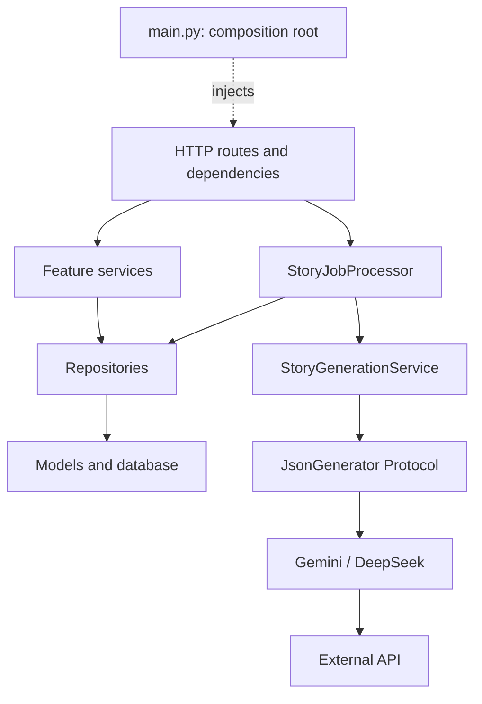

# دليل أركيتكتشر الباك إند

التصميم **modular monolith**: تطبيق واحد وقاعدة بيانات واحدة، مع تقسيم منطق العمل حسب الـfeature، ثم فصل المسؤوليات داخل كل feature. مناسب كأساس لمشاريع FastAPI، مع تغيير الموديولات وأدوات التشغيل حسب احتياجات المشروع. هذا الدليل يصف الكود الحالي وحدوده.

## خريطة المشروع

```text
backend/
├── app/
│   ├── main.py
│   ├── core/                  # إعدادات وأخطاء عامة
│   ├── api/
│   │   ├── router.py
│   │   ├── dependencies.py
│   │   ├── error_handlers.py
│   │   └── routes/            # health.py, stories.py, jobs.py
│   ├── db/                    # base.py, session.py, registry.py, health.py
│   ├── integrations/llm/      # adapters وعقد عام لتوليد JSON
│   └── modules/
│       ├── stories/           # تخزين وقراءة وتوليد القصص
│       └── jobs/              # إنشاء وتنفيذ وتتبع jobs
├── alembic/versions/           # تاريخ تغييرات قاعدة البيانات
├── tests/
│   ├── unit/                  # قواعد المجال، adapters، وحدود الأركيتكتشر
│   ├── integration/           # HTTP + services + قاعدة بيانات فعلية للاختبار
│   ├── fixtures/
│   └── support.py
├── docs/architecture.md
├── .env.example
├── alembic.ini
├── pyproject.toml
├── requirements.txt
├── requirements-dev.txt
└── README.md
```

ملفات `__init__.py` لتعريف الـpackages فقط، بدون فتح اتصالات أو تنفيذ business logic. `.venv` و`__pycache__` ملفات بيئة/تشغيل، و`.env` إعداد محلي سري. `ARCHITECTURE.local.md` ملاحظات محلية عن التنظيم القديم؛ المرجع المعتمد هو هذا الملف.

## وظيفة كل ملف

### تجميع التطبيق والـHTTP

| الملف داخل app | مسؤوليته |
| --- | --- |
| `main.py` | **Composition root**: ينشئ Database والمزوّد وStoryGenerationService وStoryJobProcessor، ويربطها بالتطبيق. يقبل dependencies بديلة للاختبار، ويغلق قاعدة البيانات في lifespan. |
| `core/config.py` | تعريف Settings وتحميلها عبر `get_settings()`؛ `.env` تُقرأ نسبةً إلى مجلد backend، والأسرار `SecretStr`. لا ينشئ engine أو services. |
| `core/exceptions.py` | أخطاء تطبيقية معروفة ذات رسائل مناسبة للعميل، دون HTTP status codes أو SQL. |
| `api/router.py` | تجميع routers تحت `/api`. |
| `api/dependencies.py` | ربط HTTP بالموارد: session لكل request، وservices وprocessor، وقراءة/إنشاء session identifier. |
| `api/error_handlers.py` | ترجمة ResourceNotFoundError إلى 404، والأخطاء التطبيقية الأخرى إلى 500، مع شكل `detail` الموحد. |
| `api/routes/stories.py` | استقبال الإنشاء، استدعاء job service، أخذ snapshot لرد pending، وجدولة processor. وقراءة القصة عبر StoryService. |
| `api/routes/jobs.py` | قراءة job عبر StoryJobService. |
| `api/routes/health.py` | تحويل readiness إلى HTTP 200/503. الاستعلام نفسه في db/health.py. |

الـroutes لا تنشئ providers، ولا تنفذ SQL، ولا تطبق قواعد graph. وجود endpoint إنشاء القصة في stories route منطقي من ناحية HTTP، رغم أنه يبدأ use case تنشئ job.

### قاعدة البيانات

| الملف | مسؤوليته |
| --- | --- |
| `db/base.py` | تعريف DeclarativeBase وmetadata فقط؛ استيراد models لا يحتاج اتصالًا أو إعداد DATABASE_URL. |
| `db/session.py` | كائن Database يملك engine وsession_factory وclose؛ الموارد خاصة بكل app instance. |
| `db/registry.py` | تسجيل جميع models صراحة ليراها Alembic وتهيئة جداول الاختبار؛ أضف أي model جديدة هنا. |
| `db/health.py` | readiness query وإخفاء تفاصيل فشل الاتصال عن العميل. |

### موديول stories

| الملف | مسؤوليته |
| --- | --- |
| `modules/stories/models.py` | Story وStoryNode وأعمدتهما وعلاقاتهما؛ تخزين فقط. |
| `modules/stories/schemas.py` | عقود API: StoryCreateRequest وStoryOptionResponse وStoryNodeResponse وCompleteStoryResponse. |
| `modules/stories/repository.py` | تحميل قصة وعقدها وحفظ قصة مولدة؛ يترجم model-local IDs إلى database IDs. ينفذ flush عند الحاجة دون commit. |
| `modules/stories/service.py` | use case قراءة القصة: التحقق من وجودها ووجود root وتجميع الرد، مع طلب البيانات من repository. |
| `modules/stories/generation.py` | توليد القصة عبر JsonGenerator محقونة، ترجمة أخطاء المزوّد، parsing وفحص النتيجة، وإعادة التصحيح بحد أقصى مضبوط عند فشل validation. لا يحفظ ولا يختار provider فعلية. |
| `modules/stories/generation_schemas.py` | GeneratedStory وGeneratedStoryNode وGeneratedStoryOption وقواعد graph: uniqueness، references، reachability، depth، endings، cycles. |
| `modules/stories/prompts.py` | STORY_PROMPT وbuild_story_prompt في مكان واحد. تعليمات القصة جزء من مجال stories، وليست core عامة أو تفاصيل provider. |

عقد التوليد مختلف عن عقد API: IDs التي يولدها الموديل مؤقتة، بينما API ترجع IDs حقيقية محفوظة في قاعدة البيانات.

### موديول jobs

| الملف | مسؤوليته |
| --- | --- |
| `modules/jobs/models.py` | تخزين StoryJob. |
| `modules/jobs/schemas.py` | عقد StoryJobResponse. |
| `modules/jobs/status.py` | StoryJobStatus: مصدر واحد لحالات pending/processing/completed/failed، والتخزين يظل نصيًا. |
| `modules/jobs/repository.py` | SQL لإنشاء/قراءة job والاستحواذ عليها وتحديثها؛ بدون commit. |
| `modules/jobs/service.py` | use cases الإنشاء والقراءة؛ يملك transaction الإنشاء لضمان commit قبل تشغيل المهمة. |
| `modules/jobs/processor.py` | orchestration وتحديد commits/rollback باستخدام session مستقلة وgenerator محقونة. يمكن استدعاء process(job_id) من task runner آخر. |

التنسيق بين jobs وstories موجود صراحة في processor. لا يتم إخفاء اعتماد الموديولين داخل generic repository أو provider.

### تكاملات LLM

| الملف | مسؤوليته |
| --- | --- |
| `integrations/llm/contracts.py` | JsonGenerationRequest وJsonGenerator Protocol، دون معرفة بالقصص أو قاعدة البيانات. |
| `integrations/llm/exceptions.py` | ModelProviderError وفروعه؛ رسائل آمنة، دون إرجاع أجسام أخطاء upstream للعميل. |
| `integrations/llm/factory.py` | اختيار implementation من Settings عند تجميع التطبيق. |
| `integrations/llm/deepseek.py` | طلبات DeepSeek/OpenRouter والتوثيق وmodel aliases وصيغة الردود والأخطاء. |
| `integrations/llm/gemini.py` | طلبات Gemini وتجميع text parts وتجاهل thought parts وصيغة الردود والأخطاء. |
| `integrations/llm/json_schema.py` | تبسيط schema المرسلة إلى Gemini دون تعديل الأصل؛ فحص المجال الكامل يظل في feature. |

المزوّد يستقبل prompt وschema ويرجع نصًا. parsing وفحص قواعد graph مسؤولية stories. يمكن استخدام نفس adapter لتوليد invoice أو report بدون استيراد stories.

### التشغيل والمهاجرات والاختبارات

| الملف أو المجلد | مسؤوليته |
| --- | --- |
| `alembic/env.py` | إعداد URL وربط Alembic بـmetadata المسجلة في db/registry.py. |
| `alembic/script.py.mako` | قالب revision جديدة. |
| `alembic/versions/ffc0d4e1dc9f_create_initial_tables.py` | تاريخ إنشاء الجداول والفهارس. |
| `alembic/versions/f1429033f552_create_initial_tables.py` | revision تاريخية فارغة؛ اسمها ليس مثاليًا، لكن لا نعيد كتابة تاريخ migrations مطبق لمجرد تحسين التسمية. |
| `alembic.ini`, `alembic/README` | إعداد وتعريف Alembic؛ URL الفعلية من Settings. |
| `requirements.txt` | اعتمادات runtime. |
| `requirements-dev.txt` | اعتمادات runtime بالإضافة إلى SQLite test driver وRuff. |
| `pyproject.toml` | تنسيق Ruff، ترتيب imports وقواعد lint؛ يستثني ملفات revision التاريخية. |
| `.env.example` | أسماء الإعدادات وقيم أمثلة بدون أسرار. |
| `README.md` | التشغيل والإعداد وأوامر التحقق وروابط التوثيق. |
| `tests/support.py` | إعدادات اختبار صريحة وتحميل fixture؛ لا يعتمد على أسرار .env. |
| `tests/fixtures/branching_story.json` | قصة اختبار مستقلة عن أي provider؛ تستخدمها أيضًا اختبارات frontend. |
| `tests/unit/integrations/test_providers.py` | اختبار adapters باستخدام MockTransport ومهام JSON عامة. |
| `tests/unit/stories/test_generation.py` | تجهيز prompt وترجمة أخطاء المزوّد وفحص مخرجاته دون DB. |
| `tests/unit/stories/test_generation_schemas.py` | قواعد graph في isolation. |
| `tests/unit/test_architecture.py` | اختبارات حدود الاعتماديات وعدم إنشاء engine عند استيراد models/domain. |
| `tests/integration/test_story_flow.py` | HTTP + services + SQLite فعلية؛ تشمل remapping، rollback، atomic claim، lifecycle وعزل الموارد. |

## اتجاه الاعتماديات



- `core` لا يعتمد على API أو features أو database resources.
- `integrations` لا تستورد features أو models أو prompts الخاصة بها.
- features لا تستورد FastAPI أو app.main أو providers الفعلية.
- repositories تملك SQL؛ services/processors تملك use cases وحدود transactions.
- API تستخدم services؛ بقية الطبقات لا تستدعي API.
- اختيار implementations الفعلية يتم في composition root والـfactory.
- `db/registry.py` استثناء مقصود لتسجيل models؛ لا يُستورد من business logic.

لا توجد global session أو factory مخفية داخل service. dependency جديدة تدخل من constructor وتُربط في composition root أو HTTP dependencies. `get_settings()` cached عند حدود التطبيق؛ لا تنشئ Settings وقت استيراد كل ملف.

## مسار الإنشاء وحدود الـtransactions

1. route تمرر theme وsession identifier إلى StoryJobService.
2. service تحفظ pending وتعمل commit قبل جدولة BackgroundTasks. الرد يأخذ snapshot حتى لا يتغير إلى processing/completed أثناء إرساله.
3. processor تفتح session جديدة وتنفذ conditional UPDATE من pending إلى processing. عامل واحد يستطيع أخذ job؛ المحاولات الأخرى تخرج دون استدعاء الموديل.
4. يتم commit لحالة processing قبل انتظار الشبكة، دون إبقاء database transaction مفتوحة طوال انتظار LLM.
5. generator تتحقق من النتيجة. repository تحفظ القصة والعقد وتترجم كل choice ID إلى ID حقيقية.
6. القصة والعقد وروابطها وحالة completed تُحفظ في commit واحدة.
7. الفشل يعمل rollback لكل الكتابات الجزئية، ثم transaction جديدة لتسجيل failed. الأخطاء المعروفة تعرض رسائل آمنة، وغير المعروفة تعرض رسالة موحدة وتفاصيلها في logs.

الـrepositories لا تعمل commit حتى تستطيع use case تجميع أكثر من عملية في transaction واحدة. تغيير provider أو transport لا يغير هذه القاعدة.

## إضافة feature في مشروع آخر

1. أنشئ `modules/<feature>/` باسم مجال واضح مثل orders أو customers.
2. أضف models للبيانات المخزنة، schemas للعقود، repository للاستعلامات وservice لقواعد الاستخدام. أضف الملفات الأخرى عندما توجد مسؤولية فعلية تستحق الفصل.
3. سجّل models في db/registry.py وأنشئ migration يصف اسمها التغيير الفعلي، مع مراجعة SQL المولدة.
4. أضف api/routes/<feature>.py والـdependencies ثم سجل router في api/router.py.
5. مرر الخدمات الخارجية عبر constructor وعقد قابلة للتبديل، واربط implementation عند تجميع التطبيق.
6. اختبر قواعد المجال كـunit tests، ثم الـuse case كاملة عبر HTTP وقاعدة بيانات لفحص transactions.

لا تبدأ بـBaseService/BaseRepository/UnitOfWork أو event bus في كل مشروع. أضف abstraction عند وجود تكرار فعلي أو سبب واضح لتبديل implementation. لا تقسّم كل دالة إلى ملف مستقل، ولا تجمع مسؤوليات غير مترابطة في utils.py.

## إضافة provider

نفّذ `generate_json(JsonGenerationRequest) -> str` في adapter جديدة، مع حقن Settings وHTTP transport للاختبارات، وترجمة أخطاء الخدمة إلى ModelProviderError. سجلها في factory والإعدادات وأضف اختبارات النقل. منطق القصة وقواعد graph لا يحتاجان تعديلًا.

## قواعد التسمية

- أسماء feature folders بالجمع: stories/jobs؛ classes تصف الدور: StoryRepository/StoryJobProcessor.
- models للتخزين، schemas لعقود API، generation_schemas لعقد الموديل، repository للـSQL، service للـuse cases، processor لتنسيق تنفيذ job.
- prompts تخص feature؛ لا تنتقل إلى core لمجرد استخدامها مع أكثر من provider.
- JsonGenerator اسم capability، وGeminiProvider اسم implementation.
- migrations القديمة تاريخ؛ migrations الجديدة تُسمى بأثرها مثل add_order_status بدل create_initial_tables المتكررة.

## حدود هذا الأساس

- BackgroundTasks تشغيل داخل process التطبيق، وليس durable queue. توقف العملية قد يترك job processing. Atomic claim يمنع التنفيذ المتزامن المكرر لكنه لا يضمن crash recovery أو exactly-once لتكلفة LLM. مشروع يحتاج recovery/retries مضمونة يحتاج durable runner وسياسة leases/retries، مع إبقاء orchestration خارج HTTP.
- session cookie تعريف زائر وليست authentication أو authorization. القصص متاحة بالـIDs. البيانات الخاصة تحتاج هوية وفحص ملكية في use cases والاستعلامات.
- validation يرفض مخرجات الموديل غير الصحيحة. `STORY_GENERATION_MAX_ATTEMPTS` يحدد محاولات التوليد والتصحيح: الافتراضي 2 (الأولى + تصحيح واحد)، والمسموح 1 إلى 3. التصحيح يرسل الأخطاء والرد السابق للمزوّد، ويستهلك طلبًا إضافيًا قد تكون له تكلفة. أخطاء الشبكة والصلاحيات والرصيد والـquota لا تُعاد بهذه السياسة. لا تُحفظ نتيجة غير صالحة، والسجلات تعرض سبب الرفض دون القصة أو prompt كاملة.
- PostgreSQL هي القاعدة الإنتاجية وSQLite للاختبارات السريعة. أضف PostgreSQL integration tests عند إدخال locking أو خصائص خاصة بها.
- logging/observability وCORS وسياسات cookies وdeployment تُضبط حسب المشروع. نسخ بنية المجلدات لا يحقق هذه المتطلبات تلقائيًا.

## أوامر التحقق

من مجلد backend:

```sh
python -m unittest discover -s tests -v
ruff check app tests alembic/env.py
ruff format --check app tests alembic/env.py
alembic check
```

ومن frontend: `npm test` و`npm run build` عند تعديل API أو fixture مشتركة. الاختبارات العادية لا تحتاج مفاتيح حقيقية أو استدعاءات LLM مدفوعة.

## خريطة النقل من التنظيم السابق

| السابق | الحالي |
| --- | --- |
| core/database.py | db/base.py + db/session.py + api/dependencies.py |
| core/lifespan.py | lifespan داخل create_app في main.py |
| core/prompts.py + providers/prompts.py | modules/stories/prompts.py |
| models/story.py وschemas/story.py | modules/stories/models.py وschemas.py |
| schemas/generated_story.py | modules/stories/generation_schemas.py |
| models/job.py وschemas/job.py | modules/jobs/models.py وschemas.py |
| providers/ | integrations/llm/ بعقد عام مستقل عن stories |
| services/story_generator.py | generation.py للتوليد + StoryRepository للحفظ |
| services/story_service.py | modules/stories/service.py + repository.py |
| services/job_service.py | modules/jobs/service.py + repository.py |
| services/exceptions.py | core/exceptions.py |
| workers/story_tasks.py | modules/jobs/processor.py |
| api/endpoints/story.py وjob.py | api/routes/stories.py وjobs.py |

عناوين HTTP وحقول JSON وأسماء الجداول باقية. مسارات Python الداخلية وأسماء بعض schema classes تغيرت؛ السكربتات الخارجية التي تستوردها تحتاج تحديث imports، والتطبيق يحتاج restart بعد النقل.
